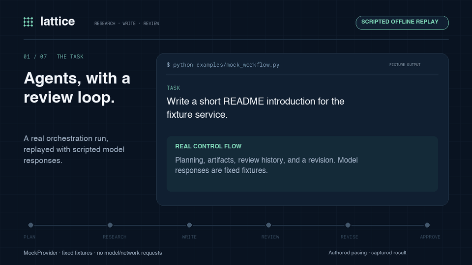
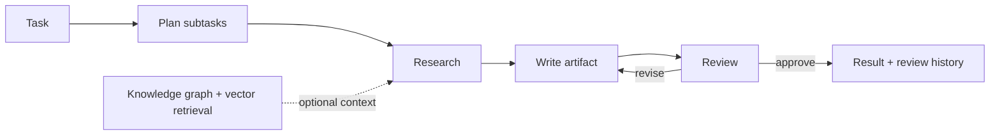

# Lattice

**Research, write, review, and revise—with the workflow made explicit.**

Lattice is a Python multi-agent platform built around a LangGraph state machine. It decomposes tasks, passes research artifacts to a writer, and routes drafts through a reviewer. Knowledge-graph and vector-retrieval components provide context; a FastAPI service exposes task status, artifacts, and audit events.

[Run the offline example](#try-the-workflow) · [Development guide](docs/development.md) · [Architecture](#how-it-works)

[](docs/assets/lattice-offline-demo.webm)

**[Watch the 34-second walkthrough](docs/assets/lattice-offline-demo.webm)** · [Static summary](docs/assets/offline-workflow.svg) · [Demo notes](docs/demo.md)

*A replay of the real orchestrator running with `MockProvider`. The model responses are scripted fixtures; the planning, artifact history, and review loop execute in Lattice.*

*Scripted offline demonstration · actual orchestrator output. [Full recorded fixture output](docs/assets/mock-workflow.txt).*

## Try the workflow

Use Python 3.11 or later:

```bash
git clone https://github.com/sudhanvad18/Lattice.git
cd Lattice
python3 -m venv .venv
source .venv/bin/activate
python -m pip install -e '.[dev,local]' prometheus-client
python examples/mock_workflow.py
```

This example runs the real orchestrator with **scripted model responses**. It exercises research, artifact creation, rejection, and revision without a running model, API key, or external write:

```text
LATTICE / OFFLINE WORKFLOW
Provider: MockProvider (scripted responses)
Network/model requests: none
Flow: plan -> research -> write -> reject -> revise -> approve
Status: completed
Artifacts: 3 (1 research, 2 document versions)
Reviews: rejected -> approved
Provider calls: 6
```

The fixture demonstrates control flow, not model quality. For a model-backed run, see [the local Ollama demo](docs/development.md#model-backed-demo).

## How it works



The orchestrator tracks dependencies between research and writing subtasks. Reviewer feedback becomes context for the next draft. Agents share a provider interface, so the same workflow can use Ollama, Anthropic, OpenAI, or a mock provider in tests.

## What's implemented

| Component | Behavior |
| --- | --- |
| Agent runtime | Planning, research/writing dispatch, artifact review, revision loops, and a tool-use interface. |
| Knowledge layer | NetworkX/Neo4j graph backends, ChromaDB storage, document ingestion, retrieval, and reranking components. |
| Task API | Submit/list tasks; retrieve status, results, and audit events; stream task events over WebSocket. |
| Write-back library | File, GitHub, and knowledge-graph handlers with validation, approval gates, history, and rollback interfaces. |
| Observability and evaluation | Local trace records, optional exporters, metrics definitions, evaluation utilities, and mock-based regression tests. |

The Next.js dashboard, MCP server, and deployment manifests are integration surfaces under development. The default API task path does not automatically invoke the write-back engine or enforce its approval gates. The dashboard's current endpoint contracts need alignment with the API; [development notes](docs/development.md#integration-status) document those boundaries.

## Repository map

```text
packages/core/lattice/  Agents, knowledge/retrieval, write-back, observability
packages/api/          FastAPI task service and audit records
packages/mcp/          MCP server source
packages/dashboard/    Next.js / React / TypeScript interface
examples/              Offline orchestration example
tests/                 Component and mock-provider workflow tests
deploy/                Helm and Terraform configuration
docker/                Container and observability configuration
```

## Develop

The package manifest is the root `pyproject.toml`. Run tests from the repository root:

```bash
python -m pytest
```

For the supported local service commands, configuration variables, focused offline checks, and demo recording path, see [docs/development.md](docs/development.md). Test output and recorded benchmark artifacts should accompany any published quality or performance claims.
